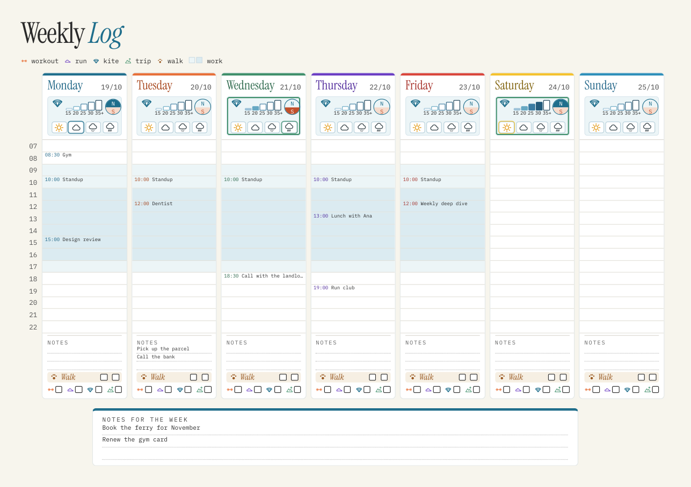

# weekpage

A printable weekly planner page. One A4 landscape sheet with seven day columns, hour rows, a wind
box per day and tick boxes for the things you want to keep track of. It fills in what it already
knows (your calendar events, the wind forecast for your spots, anything you give it) and leaves the
rest for you to write by hand.



## Install

```bash
pip install weekpage
python -m playwright install chromium
```

The page is drawn as HTML and printed to PDF by a headless Chromium, so the text and lines are
vector and stay sharp at any size.

## Use

```bash
weekpage gather -s settings.toml -o week.json          # next week, from your calendars and the forecast
weekpage render week.json -s settings.toml -o week.pdf
weekpage print week.pdf --printer Office               # any CUPS printer, through lp
```

`gather` takes `--monday 2026-10-19` for a particular week and `--given items.json` (more than
once if you like) to add items yourself. Warnings (a calendar that did not answer, a forecast that
came back empty) are printed and the page is still made, with those parts left blank.

`week.json` is the whole week as plain data, so you can also write or edit it yourself before
rendering. Every item records where it came from.

## Settings

Start from [`examples/settings.toml`](examples/settings.toml). Each part is optional.

- `title` is the two words at the top (the second one is drawn in italic).
- `hours` is the first and last hour row.
- `[work]` shades your working hours on the weekdays you list, with a darker `core` band and
  lighter `flex` bands.
- `[[ticks]]` are the tick boxes at the bottom of each day, each with a name, an icon and a
  colour. The icons are `dumbbell`, `shoe`, `kite`, `mountain`, `paw`, `sun`, `cloud`, `drizzle`
  and `rain`.
- `[walks]` adds a row of boxes per day for a repeated thing (dog walks, medicine, practice).
- `[colours]` sets the page, the day bars, the day names and the work bands.
- `[art]` places your own pictures: a banner at the top right and one picture with a caption at
  each end of the week notes. Paths are relative to the settings file.
- `[wind]` sets what counts as a good day (`min_knots` for at least `min_hours` daylight hours)
  and your spots. Each spot has a label shown in the compass, coordinates and `wind_from`, the
  sector of wind directions it works with, in degrees clockwise from north (`[300, 60]` wraps
  through north). On each day the spot whose sector matches the wind is the one shown.
- `[[calendars]]` are `.ics` files or links (Google Calendar gives one under "Secret address in
  iCal format"). Events you declined (`me` lists your addresses), cancelled events and the same
  event seen twice are left out. All-day events go into the day's notes, except titles that
  contain a word from `skip`.

## Items given directly

```json
{
  "items": [{"date": "2026-10-21", "start": "18:30", "end": "19:30", "title": "Call"}],
  "notes": [{"date": "2026-10-22", "text": "Pay rent"}],
  "off": [{"date": "2026-10-28", "name": "Holiday"}],
  "week": ["Book flights"]
}
```

A day in `off` has no work band and shows its name.

## More sources

- `weekpage.sources.google.GoogleCalendarSource` reads Google Calendar through its API with a
  refresh token from your own OAuth client (`refresh_token_getter(client_id, client_secret,
  refresh_token)`). It sees more than an `.ics` export can, so it also leaves out out-of-office,
  working-location and birthday events, and events you declined.
- `weekpage.sources.screenshot.ScreenshotSource` reads a screenshot of a calendar's week view, for
  a calendar you cannot connect. It finds the day headers and hour labels and places each event by
  its position. Titles cut off in the picture keep their `...`, and days the picture does not show
  are returned as warnings. It uses the text recognition built into macOS, so install it with
  `pip install 'weekpage[macos]'`.
- `weekpage.lines.parse_line("Wed 18:00-19:00 Physio", monday)` turns one line of text into an item.

## Writing a source

A source is any object with a `name` and a `fill(week, settings)` method that adds to the week and
returns a list of warnings. The forecast source is about 80 lines and a good example
([`sources/openmeteo.py`](src/weekpage/sources/openmeteo.py)). Pass your sources to
`weekpage.gather.gather(monday, settings, sources)`.

## Forecast

The included forecast comes from [Open-Meteo](https://open-meteo.com), which is free and needs no
account. Wind is in knots at 10 m.

## Licence

MIT. The bundled fonts, Instrument Serif and IBM Plex Mono, are under the SIL Open Font License
(the licence files are next to them in `src/weekpage/fonts`).
